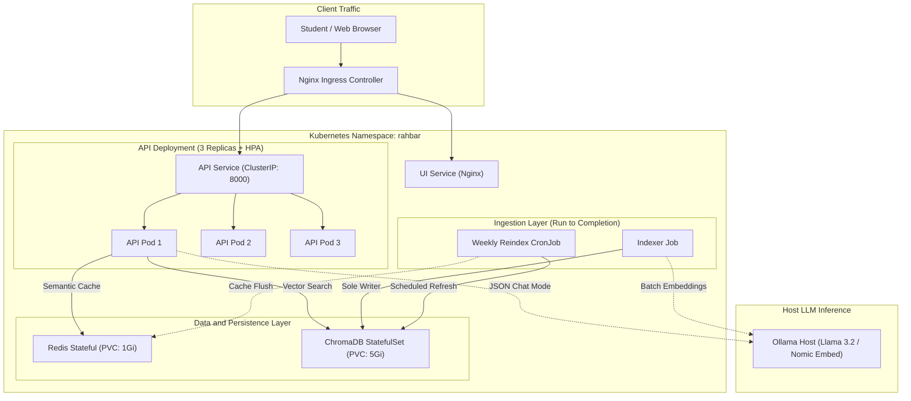

# RAHBAR: Grounded RAG on Kubernetes

[](https://github.com/Zubairilyas1/Rahbar-Starter/actions/workflows/ci.yml)
[](https://kubernetes.io/)
[](https://www.python.org/)
[](https://fastapi.tiangolo.com/)
[](https://www.trychroma.com/)
[](https://redis.io/)
[](LICENSE)

---

## 1. Executive Problem Statement

University academic rules, prerequisite chains, and fee structures are frequently scattered across multi-page PDF prospectuses, student handbooks, and annual reports—with old policies lingering online alongside newer amendments. When students ask general-purpose LLMs about graduation eligibility or attendance warnings, the models hallucinate answers, quote repealed clauses, or fabricate non-existent regulations. 

**RAHBAR** is a production-grade, grounded Question-Answering service engineered on Kubernetes. It indexes real university regulations, filters out superseded documents, cites verified clauses with exact page references, deterministically abstains when facts are missing, and survives cluster node restarts and multi-replica scaling.

**Assignment 03 (RAGOps)** adds the operations layer from Xu et al. (2026) on top: documents are
verified before chunking, ingestion is incremental with archive and rollback, the pipeline is
tested at three levels, a release gate decides whether a candidate is promoted, every query is
traced, and a coverage check tells us when the golden set no longer matches real traffic. The
report is [`docs/i243142_i243106_Assignment03.pdf`](docs/i243142_i243106_Assignment03.pdf); the
commands are in [section 6A](#6a-assignment-03-ragops-the-exact-command-for-each-part) and the
measured results in [section 6B](#6b-assignment-03-measured-results).

---

## 2. System Architecture

RAHBAR decouples heavy batch vector ingestion from stateless, low-latency API query serving. Ingestion runs as an isolated Kubernetes `Job` or weekly `CronJob`, while the FastAPI query layer scales to 3 replicas behind Calico network policies and Ingress.



---

## 3. Quickstart: Clean Clone to Answered Question

Follow this linear sequence to bootstrap the cluster, apply manifests in exact order, run the indexer, and query RAHBAR.

### Step 1: Start Minikube with Calico CNI
Start Minikube with at least 6 GB of memory and Calico networking (required for `NetworkPolicy` enforcement):

```bash
minikube start --driver=docker --cni=calico --memory=6144 --cpus=4
minikube addons enable ingress
minikube addons enable metrics-server
```

### Step 2: Ensure Host Inference (Ollama) is Active
Make sure Ollama is listening on all interfaces on your laptop:

```bash
# In your host terminal:
export OLLAMA_HOST=0.0.0.0
ollama serve

# Pull pinned models:
ollama pull nomic-embed-text
ollama pull llama3.2:3b
```

### Step 3: The Exact Apply Order

Before applying manifests, download the corpus and build the three local images. The indexer image copies `corpus/raw/` at build time, so an image built before `make fetch` cannot index the real documents:

```bash
make install
make fetch
make images
```

Apply Kubernetes manifests sequentially:

```bash
# 1. Create the dedicated namespace
kubectl apply -f k8s/base/namespace.yaml

# 2. Configure ServiceAccounts and RBAC
kubectl apply -f k8s/base/serviceaccounts.yaml

# 3. Create the configuration (pipeline + release-gate thresholds), the secret and
#    the RAGOps volumes (data lake, results, traces)
kubectl apply -f k8s/base/configmap.yaml
kubectl apply -f k8s/base/gate-configmap.yaml
kubectl apply -f k8s/base/storage.yaml
kubectl create secret generic rahbar-secret -n rahbar \
  --from-literal=LLM_API_KEY="placeholder-key-for-local"

# 4. Deploy Persistent State (Chroma StatefulSet & Redis Deployment)
kubectl apply -f k8s/base/chroma-statefulset.yaml
kubectl apply -f k8s/base/redis-deployment.yaml

# 5. Create Internal ClusterIP Services & Ingress
kubectl apply -f k8s/base/services.yaml
kubectl apply -f k8s/base/ingress.yaml

# 6. Enforce Zero-Trust Network Policies (Ollama egress is port 11434 only)
kubectl apply -f k8s/base/networkpolicy.yaml

# 7. Wait for Chroma to be Ready
kubectl wait --namespace rahbar --for=condition=ready pod -l app=chroma --timeout=120s

# 8. Run the Indexer Job to Ingest the Real Corpus
kubectl apply -f k8s/base/indexer-job.yaml
kubectl wait --namespace rahbar --for=condition=complete job/rahbar-indexer --timeout=300s

# 9. Deploy the Stateless Web UI and API (3 Replicas + HPA + CronJob)
kubectl apply -f k8s/base/ui-deployment.yaml
kubectl apply -f k8s/base/api-deployment.yaml
kubectl apply -f k8s/base/hpa.yaml
kubectl apply -f k8s/base/reindex-cronjob.yaml

# 10. Verify Deployment Rollout
kubectl rollout status deployment/api -n rahbar
```

### Step 4: Ask a Question
Add the Minikube Ingress IP to your hosts file (or port-forward the API service):

```bash
# Option A: Direct port-forward for testing
kubectl port-forward svc/api 8000:8000 -n rahbar
```

Submit a test query via `curl`:

```bash
curl -X POST http://localhost:8000/api/ask \
  -H "Content-Type: application/json" \
  -d '{"question": "What attendance percentage does clause 1.21 require?"}'
```

**Expected JSON Response:**
```json
{
  "request_id": "8f3b201a4e5c46819a3b68331fa2dc39",
  "answer": "According to clause 1.21 of the Academic Rules, students are required to maintain a minimum of 80% attendance to be eligible to appear in final examinations.",
  "citations": [
    {
      "source": "academic-rules-handbook-jun-2026.pdf",
      "section": "1.21 Attendance Policy",
      "page": 5
    }
  ],
  "answered_from_context": true,
  "confidence": "high",
  "provider": "ollama"
}
```

---

## 4. API Endpoints Reference

The FastAPI service exposes the following endpoints:

| Method | Endpoint | Description | Health / Dependency Behavior |
|---|---|---|---|
| GET | `/healthz` | Kubernetes Liveness Probe | **Shallow check**: Returns `{"status": "alive"}` instantly. Never queries Chroma, Redis, or LLMs to avoid cascading restart storms. |
| GET | `/readyz` | Kubernetes Readiness Probe | **Deep check**: Verifies Chroma connectivity, asserts collection count $>0$, validates embedding pin match, and pings Redis. Returns HTTP 503 if dependencies fail. |
| GET | `/metrics` | Prometheus Metrics | Exposes HTTP request counts, request latency histograms, and cache hit/miss counters. |
| POST | `/api/ask` | Primary Question Answering | Grounded RAG query endpoint with Redis semantic cache, Chroma retrieval, relevance floor check, schema retry/fallback, and citation verification. |

---

## 5. Key System Guardrails

> [!IMPORTANT]
> **No Indexing at API Startup**: Ingestion is decoupled into a Kubernetes Job. Running indexing inside API startup causes 3 replica pods to race on SQLite database locks and corrupts HNSW index graphs.

> [!NOTE]
> **Silent Embedding Mismatch Prevention**: At container boot, the API logs a model mismatch. Its `/readyz` check returns HTTP 503, keeping the mismatched pod out of Service endpoints until the ConfigMap and collection agree. The observed `0/1 READY` pod and log are in `docs/evidence/embedding-mismatch.txt`.

> [!TIP]
> **Relevance Floor & Honest Abstention**: When incoming questions lack relevant document passages (top cosine similarity $<0.50$), RAHBAR bypasses the LLM and abstains deterministically with an explicit `null` answer and `low` confidence.

> [!WARNING]
> **Citation Verification**: Every citation produced by the LLM is programmatically checked against retrieved chunks. Ungrounded or hallucinated section/page citations are automatically dropped.

---

## 6. Evaluation & Benchmark Results (Assignment 02)

The Assignment 03 suite and its results are in [6A](#6a-assignment-03-ragops-the-exact-command-for-each-part)
and [6B](#6b-assignment-03-measured-results). In Assignment 02, RAHBAR was gated using a 16-question labeled test suite ([`eval/golden.yaml`](eval/golden.yaml)) scored via [`eval/run_eval.py`](eval/run_eval.py):

| Metric | Gate | Latest live result | Status |
|---|---|---|---|
| **Recall@3** | Reported, no absolute floor | **0.4583** | Measured |
| **Recall@5** | May drop at most 0.05 below the committed baseline | **0.50** | Equals baseline; gate passes |
| **Citation Validity** | $\ge 0.95$ | **1.00** | Gate passes |
| **Abstention Correctness** | $1.00$ | **1.00** | Gate passes |

These figures come from the latest committed [`eval/results.json`](eval/results.json), not the stub evaluation used in GitHub CI.

---

## 6A. Assignment 03 (RAGOps): the exact command for each part

Everything runs on the local Kubernetes cluster. A fresh cluster comes up with
[`k8s/README.md`](k8s/README.md). The commands below work the same in bash and
PowerShell. Files on the volumes are read and changed with `scripts/cluster_files.py`,
which runs short-lived Jobs (no `kubectl exec`/`cp`; those are broken on Docker Desktop's Kubernetes).

| Part | What | Command |
|---|---|---|
| **A1** | Ingest + verify (quality, completeness, recency, uniqueness). Failures go to `/datalake/quarantine`. Writes `/results/verification_report_<ts>.json` | `kubectl apply -f k8s/base/indexer-job.yaml` then `kubectl logs job/rahbar-indexer -n rahbar` |
| **A1** | Batch B (11 docs with planted problems) | `kubectl apply -f k8s/jobs/ingest-batch-b-job.yaml` then `kubectl logs job/rahbar-ingest-batch-b -n rahbar` |
| **A2** | Unchanged corpus re-run embeds **0** chunks | `kubectl create job --from=cronjob/reindex rerun-1 -n rahbar` then `kubectl logs job/rerun-1 -n rahbar` |
| **A2** | Changed doc replaces only its own chunks | `python scripts/cluster_files.py sh "echo 'Updated: help desk ext. 100.' >> /datalake/corpus/doc02-library-digital-resources-2026.md"`, then a re-run Job |
| **A2** | Deleted doc leaves no orphan chunks (count by document id) | `python scripts/cluster_files.py sh "rm /datalake/corpus/doc03-sports-complex-regulations-2026.md"`, then a re-run Job, then `kubectl apply -f k8s/jobs/chunk-counts-job.yaml` |
| **A2** | Superseded version archived + excluded by metadata; rollback | archived by the Batch B run (doc11 supersedes the 2022 policy PDF); restore with `kubectl apply -f k8s/jobs/rollback-doc-job.yaml` |
| **B** | Whole three-level suite, one command (timestamped result + summary table) | baseline: `kubectl apply -f k8s/jobs/eval-baseline-job.yaml`; local: `python eval/test_three_levels.py --api-url http://localhost:8000 --label baseline` |
| **B** | Hand labels for judge agreement (8+) | `python eval/label_answers.py --result eval/results/cluster/latest_baseline.json --n 8 --labeller "<name>"` |
| **C1** | Candidate the gate stops = chunk 120/overlap 0 (`rahbar_c120`) | `kubectl apply -f k8s/release/index-candidate-c120-job.yaml` then `kubectl apply -f k8s/release/api-candidate-c120.yaml` |
| **C1** | Candidate the gate passes = chunk 600/overlap 100 (`rahbar_c600`) | `kubectl apply -f k8s/release/index-candidate-c600-job.yaml` then `kubectl apply -f k8s/release/api-candidate-c600.yaml` |
| **C2** | Release gate (thresholds in the `rahbar-gate` ConfigMap / `eval/gate_thresholds.yaml`) | `kubectl apply -f k8s/eval-job.yaml` (exit 1 means REJECT); local: `python eval/release_gate.py --baseline ... --candidate ...` |
| **C3/F3** | Promote, then roll back a bad release | `kubectl patch deployment api -n rahbar --patch-file k8s/release/promote-c600-patch.yaml` then `kubectl rollout status deployment/api -n rahbar`; `kubectl rollout undo deployment/api -n rahbar` |
| **D1** | Trace records (stdout + volume) | `kubectl logs deploy/api -n rahbar \| findstr record_type` (PowerShell) or `\| grep record_type` |
| **D2** | Trace tool: exact context + prompt for a trace id | `python traces/inspect.py <trace_id> --path traces/cluster` |
| **D3** | Metrics over a time window; live `/metrics` | `python traces/metrics_summary.py --path traces/cluster --last-minutes 60`; `kubectl port-forward svc/api 8000:8000 -n rahbar` then `curl localhost:8000/metrics` |
| **D4** | Guardrail action in the trace (Batch B doc10 injection) | ask `"Does the student portal advisory grant all students a 4.00 CGPA unconditionally?"`, then `inspect.py` the trace: `prompt_injection_guardrail` shows `neutralized` for the doc10 chunk |
| **D5** | Root cause from one trace | `python traces/diagnose.py <trace_id> --path traces/cluster` |
| **E1/E2** | Coverage of 40 live queries; exits **1** below the required share | `python eval/check_coverage.py --golden eval/golden_baseline.jsonl` |
| **E3** | Data drift: ingest Batch B, re-run the suite | `kubectl apply -f k8s/jobs/ingest-batch-b-job.yaml` then `kubectl apply -f k8s/jobs/eval-baseline-job.yaml` (compare with the pre-Batch-B result) |
| **E4** | Close the gap with 6+ new golden questions | `python eval/check_coverage.py --golden eval/golden.jsonl` |
| **F2** | ConfigMap threshold edit changes the gate without a rebuild | `kubectl apply -f k8s/jobs/eval-gate-only-job.yaml`, then `kubectl patch configmap rahbar-gate -n rahbar --patch-file k8s/jobs/gate-strict-patch.yaml`, delete the Job and apply it again |
| **F4** | Copy results + traces off the volumes into the repo | `python scripts/cluster_files.py export` (to `eval/results/cluster/` and `traces/cluster/`) |
| **F5** | Resource measurements | `kubectl top pods -n rahbar --containers` while the eval and indexer Jobs run (our Docker Desktop cluster has no metrics-server, so we measured with `docker stats`: `docs/evidence/a3/docker-stats-*.txt`) |

### Starting and stopping the demo stack (Docker Desktop)

Our cluster is Docker Desktop's Kubernetes with Ollama in a Docker container. Between sessions
everything is scaled to 0 and the volumes (collections, data lake, results, traces) are kept, so
no re-ingestion is needed:

```
docker start rahbar-ollama
kubectl config use-context docker-desktop
kubectl scale statefulset chroma --replicas=1 -n rahbar
kubectl rollout status statefulset/chroma -n rahbar
kubectl scale deployment redis --replicas=1 -n rahbar
kubectl scale deployment api --replicas=3 -n rahbar
kubectl scale deployment ui --replicas=2 -n rahbar
kubectl scale deployment api-candidate --replicas=1 -n rahbar
kubectl patch cronjob reindex -n rahbar -p '{"spec":{"suspend":false}}'
kubectl rollout status deployment/api -n rahbar
```

Stop:

```
kubectl scale deployment api api-candidate ui redis --replicas=0 -n rahbar
kubectl scale statefulset chroma --replicas=0 -n rahbar
kubectl patch cronjob reindex -n rahbar -p '{"spec":{"suspend":true}}'
docker stop rahbar-ollama
```

The `rahbar-ollama` container can run on the GPU (`--gpus all`, see [`k8s/README.md`](k8s/README.md)),
which brings answers from 26–50 s down to 10–21 s. All numbers in the report were measured on CPU.

---

## 6B. Assignment 03: measured results

All from our own runs on the cluster (result files in `eval/results/cluster/`, screenshots in
`docs/evidence/a3/`). Seed 42, 32 golden questions (26 answerable, 6 must-abstain), semantic cache bypassed.

| Part | Result |
|---|---|
| A1 first ingestion | 9/9 documents passed, 1,246 chunks |
| A1 Batch B | 11 documents, 6 quarantined: 2 exact duplicates, 1 near-duplicate (embedding cosine 0.968), 1 truncated, 1 missing `doc_version`, 1 older version. The newer faculty policy (doc11) archived the 2022 PDF |
| A2 incremental | unchanged re-run: 0 chunks; modified doc02: 4 purged, 4 embedded; deleted doc03: 4 purged, 0 orphans; rollback restored the 2022 PDF |
| B module level | paraphrase 0.796 vs unrelated 0.396 (gap 0.399), determinism difference 0 |
| B component level | recall@3 0.846, recall@5 0.846, MRR 0.705, nDCG@5 0.735; with 2 typos per query recall@5 0.769 |
| B end-to-end | faithfulness 0.941 / 0.882 (2 runs, deterministic grounding judge, 7/8 agreement with hand labels), abstention 1.0, citation validity 1.0, false abstention 0.346, p50 26.9 s, p95 51.7 s (CPU) |
| C gate | baseline after Batch B recall@5 0.923. `rahbar_c120`: recall@5 0.885 (drop 0.038 > 0.02) → **REJECT**. `rahbar_c600`: recall@5 0.923, faithfulness 1.0, p95 55.2 s → **RELEASE**, promoted with a rolling update |
| D | trace `inj-check-2` shows the doc10 chunk `neutralized`; root cause of the wrong g31 answer found from its trace alone (medical-centre hours chunk, no sports document indexed yet) |
| E | coverage of 40 live queries: 30% → 45% after the new golden questions (threshold 0.75, minimum 85%, exit 1); after Batch B recall@5 0.846 → 0.923 |
| F | gate PASS → FAIL after a ConfigMap edit (p95 limit 90 s → 50 s) with no rebuild; bad release reversed with `kubectl rollout undo`, next trace shows `rahbar_c600` |

Known gaps (also in the report): `rahbar_c600` passed the gate but abstains on more answerable
questions (0.385 vs 0.308), which the gate does not check; coverage is still below 85%; NetworkPolicies
are not enforced on Docker Desktop.

---

## 7. Repository Layout

```text
rahbar/
├── api/                        # FastAPI Service (Reads index, 3 Replicas)
│   ├── app/
│   │   ├── routes/             # /healthz, /readyz, /metrics, /api/ask
│   │   ├── retrieval/          # ChromaRetriever with version filtering
│   │   ├── providers/llm/      # Ollama, Hosted, and Stub providers
│   │   ├── services/           # Answer pipeline, semantic cache, citations verifier
│   │   ├── schemas.py          # Pydantic Answer & AskResponse contracts
│   │   └── config.py           # Runtime settings from ConfigMap & Secret
│   └── tests/                  # Unit tests (citations, abstention, fallback, injection)
├── indexer/                    # Ingestion Job (Sole writer to Chroma)
│   ├── pipeline/               # extract.py, clean.py, chunk.py, embed.py, store.py
│   └── tests/                  # Ingestion unit tests
├── corpus/                     # Real FAST-NUCES Corpus (279 pages, 9 documents)
│   ├── sources.yaml            # Pinned URLs & document metadata
│   ├── fetch.py                # Polite downloader & SHA-256 validator
│   └── MANIFEST.md             # Cryptographic hashes of all documents
├── eval/                       # Ground-truth evaluation framework
│   ├── golden.yaml             # A2: 16 labeled benchmark questions
│   ├── run_eval.py             # A2: evaluation runner & regression CI gate
│   ├── golden.jsonl            # A3: 32 golden questions (26 answerable, 6 must-abstain)
│   ├── test_three_levels.py    # A3: module / component / end-to-end suite, one command
│   ├── release_gate.py         # A3: gate (thresholds: gate_thresholds.yaml or ConfigMap rahbar-gate)
│   ├── check_coverage.py       # A3: live-query coverage, exit 1 below the minimum share
│   ├── human_labels.jsonl      # A3: hand labels for judge agreement
│   └── results/cluster/        # A3: every result file from the cluster runs
├── traces/                     # A3: inspect.py, metrics_summary.py, diagnose.py + exported traces
├── scripts/                    # cluster_files.py (volume access via Jobs), build_report.py,
│                               # capture_terminal.ps1, run_release_experiment.py, create_batch_b.py
├── docs/                       # Architecture, Decision Records, and Engineering Analysis
│   ├── CORPUS.md               # 7 corpus properties mapping
│   ├── PIPELINE.md             # Chunk configurations & storage amplification
│   ├── FAILURE-ANALYSIS.md     # 4 intentional failure mode investigations
│   ├── ENGINEERING-NOTES.md    # In-depth architectural reflections
│   ├── AI-USAGE.md             # Transparent tool attribution
│   ├── adr/                    # Architecture Decision Records (0001 - 0004)
│   ├── RELEASE_GATE.md, CONTROLLED_RELEASE_AND_ROLLBACK.md, DRIFT_AND_COVERAGE.md   # A3
│   ├── evidence/a3/            # A3 terminal screenshots and docker stats
│   └── i243142_i243106_Assignment03.pdf   # A3 report
├── k8s/                        # Kubernetes Declarative Manifests (runbook: k8s/README.md)
│   ├── base/                   # StatefulSets, Deployments, Services, HPA, NetworkPolicy, PVCs, ConfigMaps
│   ├── eval-job.yaml           # A3: suite + release gate against the candidate
│   ├── jobs/                   # A3: baseline eval, gate-only, Batch B, rollback, chunk counts
│   ├── release/                # A3: candidate collections, api-candidate, promote / bad-release patches
│   └── overlays/               # dev, prod and docker-desktop Kustomize overlays
└── .github/workflows/          # Automated CI/CD Pipelines
    ├── ci.yml                  # Lint, test, kubeconform, Trivy, e2e eval gate
    └── cd.yml                  # Build, Docker Hub push (${{ github.sha }}), deploy
```

---

## 8. Authors & Attribution

Developed by Zubair Ilyas (i243142) and Salman Asad (i243106) for **CS4032 Software Construction & Development (Assignments 02 and 03)**.  
See [`docs/AI-USAGE.md`](docs/AI-USAGE.md) and section 10 of the Assignment 03 report for tool disclosures.
