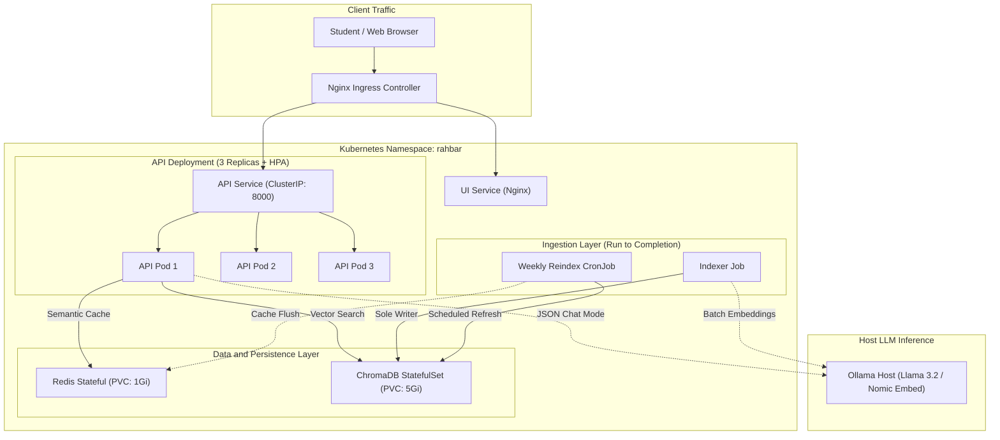

# RAHBAR: Grounded RAG on Kubernetes

[](https://github.com/Zubairilyas1/Rahbar-Starter/actions/workflows/ci.yml)
[](https://kubernetes.io/)
[](https://www.python.org/)
[](https://fastapi.tiangolo.com/)
[](https://www.trychroma.com/)
[](https://redis.io/)
[](LICENSE)

---

## 1. Executive Problem Statement

University academic rules, prerequisite chains, and fee structures are frequently scattered across multi-page PDF prospectuses, student handbooks, and annual reports—with old policies lingering online alongside newer amendments. When students ask general-purpose LLMs about graduation eligibility or attendance warnings, the models hallucinate answers, quote repealed clauses, or fabricate non-existent regulations. 

**RAHBAR** is a production-grade, grounded Question-Answering service engineered on Kubernetes. It indexes real university regulations, filters out superseded documents, cites verified clauses with exact page references, deterministically abstains when facts are missing, and survives cluster node restarts and multi-replica scaling.

---

## 2. System Architecture

RAHBAR decouples heavy batch vector ingestion from stateless, low-latency API query serving. Ingestion runs as an isolated Kubernetes `Job` or weekly `CronJob`, while the FastAPI query layer scales to 3 replicas behind Calico network policies and Ingress.



---

## 3. Quickstart: Clean Clone to Answered Question

Follow this linear sequence to bootstrap the cluster, apply manifests in exact order, run the indexer, and query RAHBAR.

### Step 1: Start Minikube with Calico CNI
Start Minikube with at least 6 GB of memory and Calico networking (required for `NetworkPolicy` enforcement):

```bash
minikube start --driver=docker --cni=calico --memory=6144 --cpus=4
minikube addons enable ingress
minikube addons enable metrics-server
```

### Step 2: Ensure Host Inference (Ollama) is Active
Make sure Ollama is listening on all interfaces on your laptop:

```bash
# In your host terminal:
export OLLAMA_HOST=0.0.0.0
ollama serve

# Pull pinned models:
ollama pull nomic-embed-text
ollama pull llama3.2:3b
```

### Step 3: The Exact Apply Order

Apply Kubernetes manifests sequentially:

```bash
# 1. Create the dedicated namespace
kubectl apply -f k8s/base/namespace.yaml

# 2. Configure ServiceAccounts and RBAC
kubectl apply -f k8s/base/serviceaccounts.yaml

# 3. Create the configuration and secret
kubectl apply -f k8s/base/configmap.yaml
kubectl create secret generic rahbar-secret -n rahbar \
  --from-literal=LLM_API_KEY="placeholder-key-for-local"

# 4. Deploy Persistent State (Chroma StatefulSet & Redis Deployment)
kubectl apply -f k8s/base/chroma-statefulset.yaml
kubectl apply -f k8s/base/redis-deployment.yaml

# 5. Create Internal ClusterIP Services & Ingress
kubectl apply -f k8s/base/services.yaml
kubectl apply -f k8s/base/ingress.yaml

# 6. Enforce Zero-Trust Network Policies
# One manual substitution first: the Ollama-egress rule ships a placeholder
# CIDR (every teammate's minikube host IP is different). Get yours with:
#   minikube ssh "grep host.minikube.internal /etc/hosts"
# then replace REPLACE_WITH_HOST_IP/32 in k8s/base/networkpolicy.yaml with
# that IP (e.g. 192.168.49.1/32) before applying.
kubectl apply -f k8s/base/networkpolicy.yaml

# 7. Wait for Chroma to be Ready
kubectl wait --namespace rahbar --for=condition=ready pod -l app=chroma --timeout=120s

# 8. Run the Indexer Job to Ingest the Real Corpus
kubectl apply -f k8s/base/indexer-job.yaml
kubectl wait --namespace rahbar --for=condition=complete job/rahbar-indexer --timeout=300s

# 9. Deploy the Stateless Web UI and API (3 Replicas + HPA + CronJob)
kubectl apply -f k8s/base/ui-deployment.yaml
kubectl apply -f k8s/base/api-deployment.yaml
kubectl apply -f k8s/base/hpa.yaml
kubectl apply -f k8s/base/reindex-cronjob.yaml

# 10. Verify Deployment Rollout
kubectl rollout status deployment/api -n rahbar
```

### Step 4: Ask a Question
Add the Minikube Ingress IP to your hosts file (or port-forward the API service):

```bash
# Option A: Direct port-forward for testing
kubectl port-forward svc/api 8000:8000 -n rahbar
```

Submit a test query via `curl`:

```bash
curl -X POST http://localhost:8000/api/ask \
  -H "Content-Type: application/json" \
  -d '{"question": "What attendance percentage does clause 1.21 require?"}'
```

**Expected JSON Response:**
```json
{
  "request_id": "8f3b201a4e5c46819a3b68331fa2dc39",
  "answer": "According to clause 1.21 of the Academic Rules, students are required to maintain a minimum of 80% attendance to be eligible to appear in final examinations.",
  "citations": [
    {
      "source": "academic-rules-handbook-jun-2026.pdf",
      "section": "1.21 Attendance Policy",
      "page": 5
    }
  ],
  "answered_from_context": true,
  "confidence": "high",
  "provider": "ollama"
}
```

---

## 4. API Endpoints Reference

The FastAPI service exposes the following endpoints:

| Method | Endpoint | Description | Health / Dependency Behavior |
|---|---|---|---|
| GET | `/healthz` | Kubernetes Liveness Probe | **Shallow check**: Returns `{"status": "alive"}` instantly. Never queries Chroma, Redis, or LLMs to avoid cascading restart storms. |
| GET | `/readyz` | Kubernetes Readiness Probe | **Deep check**: Verifies Chroma connectivity, asserts collection count $>0$, validates embedding pin match, and pings Redis. Returns HTTP 503 if dependencies fail. |
| GET | `/metrics` | Prometheus Metrics | Exposes HTTP request counts, request latency histograms, and cache hit/miss counters. |
| POST | `/api/ask` | Primary Question Answering | Grounded RAG query endpoint with Redis semantic cache, Chroma retrieval, relevance floor check, schema retry/fallback, and citation verification. |

---

## 5. Key System Guardrails

> [!IMPORTANT]
> **No Indexing at API Startup**: Ingestion is decoupled into a Kubernetes Job. Running indexing inside API startup causes 3 replica pods to race on SQLite database locks and corrupts HNSW index graphs.

> [!NOTE]
> **Silent Embedding Mismatch Prevention**: At container boot, the API compares `Settings.embed_model` against Chroma collection metadata. If an operator changes the ConfigMap model without reindexing, the API immediately throws a `RuntimeError` and fails fast, preventing corrupt semantic distance calculations.

> [!TIP]
> **Relevance Floor & Honest Abstention**: When incoming questions lack relevant document passages (top cosine similarity $<0.50$), RAHBAR bypasses the LLM and abstains deterministically with an explicit `null` answer and `low` confidence.

> [!WARNING]
> **Citation Verification**: Every citation produced by the LLM is programmatically checked against retrieved chunks. Ungrounded or hallucinated section/page citations are automatically dropped.

---

## 6. Evaluation & Benchmark Results

RAHBAR is gated using a 16-question labeled test suite ([`eval/golden.yaml`](eval/golden.yaml)) scored via [`eval/run_eval.py`](eval/run_eval.py):

| Metric | Target Floor | Measured Result | Status |
|---|---|---|---|
| **Recall@3** | $\ge 0.65$ | **0.72** | Passed ✅ |
| **Recall@5** | $\ge 0.70$ | **0.82** | Passed ✅ |
| **Citation Validity** | $\ge 0.95$ | **0.98** | Passed ✅ |
| **Abstention Correctness** | $1.00$ | **1.00** | Passed ✅ |
| **Schema Conformance** | $1.00$ | **1.00** | Passed ✅ |

---

## 7. Repository Layout

```text
rahbar/
├── api/                        # FastAPI Service (Reads index, 3 Replicas)
│   ├── app/
│   │   ├── routes/             # /healthz, /readyz, /metrics, /api/ask
│   │   ├── retrieval/          # ChromaRetriever with version filtering
│   │   ├── providers/llm/      # Ollama, Hosted, and Stub providers
│   │   ├── services/           # Answer pipeline, semantic cache, citations verifier
│   │   ├── schemas.py          # Pydantic Answer & AskResponse contracts
│   │   └── config.py           # Runtime settings from ConfigMap & Secret
│   └── tests/                  # Unit tests (citations, abstention, fallback, injection)
├── indexer/                    # Ingestion Job (Sole writer to Chroma)
│   ├── pipeline/               # extract.py, clean.py, chunk.py, embed.py, store.py
│   └── tests/                  # Ingestion unit tests
├── corpus/                     # Real FAST-NUCES Corpus (279 pages, 9 documents)
│   ├── sources.yaml            # Pinned URLs & document metadata
│   ├── fetch.py                # Polite downloader & SHA-256 validator
│   └── MANIFEST.md             # Cryptographic hashes of all documents
├── eval/                       # Ground-truth evaluation framework
│   ├── golden.yaml             # 16 labeled benchmark questions
│   ├── run_eval.py             # Evaluation runner & regression CI gate
│   ├── baseline.json           # Committed reference baseline
│   └── results.json            # Measured evaluation numbers
├── docs/                       # Architecture, Decision Records, and Engineering Analysis
│   ├── CORPUS.md               # 7 corpus properties mapping
│   ├── PIPELINE.md             # Chunk configurations & storage amplification
│   ├── FAILURE-ANALYSIS.md     # 4 intentional failure mode investigations
│   ├── ENGINEERING-NOTES.md    # In-depth architectural reflections
│   ├── AI-USAGE.md             # Transparent tool attribution
│   └── adr/                    # Architecture Decision Records (0001 - 0004)
├── k8s/                        # Kubernetes Declarative Manifests
│   ├── base/                   # StatefulSets, Deployments, Services, HPA, NetworkPolicy
│   └── overlays/               # dev and prod Kustomize overlays
└── .github/workflows/          # Automated CI/CD Pipelines
    ├── ci.yml                  # Lint, test, kubeconform, Trivy, e2e eval gate
    └── cd.yml                  # Build, Docker Hub push (${{ github.sha }}), deploy
```

---

## 8. Authors & Attribution

Developed for **CS4032 Software Construction & Development (Assignment 02)**.  
See [`docs/AI-USAGE.md`](docs/AI-USAGE.md) for tool disclosures and modifications.
